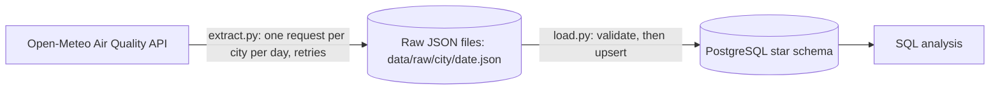

# Air Quality Pipeline


A small data pipeline in Python that pulls hourly air quality data for four Indian cities from a public API, stores every raw response on disk, and loads the cleaned readings into a PostgreSQL star schema. Re-running it is safe: loads are idempotent.

> **Data note:** the readings come from the Open-Meteo Air Quality API, which provides **modeled data at roughly 11 km resolution, not sensor measurements**. Treat the values as estimates for an area, not as what a monitoring station recorded.

## Architecture



1. **Extract** (`src/extract.py`): requests one day of hourly data per city, saves the response exactly as received, and prints a summary (rows per city, missing values, PM2.5 mean and max).
2. **Load** (`src/load.py`): reads the saved files, validates them, and upserts them into PostgreSQL.

Raw files are kept so the database can always be rebuilt without calling the API again.

## What it collects

- **Cities:** Mangaluru, Bengaluru, Delhi, Chennai
- **Variables (hourly):** `pm10`, `pm2_5`, `carbon_monoxide`, `dust`, `carbon_dioxide`, `nitrogen_dioxide` (units as returned by the API; see the Open-Meteo documentation)
- **Granularity:** one row per city per hour

## Data model

| Table | Purpose | Key columns |
|---|---|---|
| `dim_city` | One row per city | `city_id` (identity primary key), `city_name` (unique), `latitude`, `longitude` as `NUMERIC(9,6)` |
| `fact_air_quality` | One row per city per hour | primary key `(city_id, reading_time)`, six nullable `NUMERIC(8,2)` pollutant columns |

## Design decisions

- **Idempotent loads.** Both tables use `INSERT ... ON CONFLICT DO UPDATE`. Loading the same files twice leaves the same row count, and corrected values overwrite stale ones.
- **Composite primary key instead of an auto-increment id.** `(city_id, reading_time)` is what defines "the same reading", so the database itself blocks duplicates.
- **Forecast days are not loaded.** Today and later dates contain predictions, so extract skips them and load ignores their files. The rule lives in one function (`is_past`) shared by both steps and covered by tests.
- **Nulls stay NULL.** Missing API values become SQL `NULL`, not `0` and not `NaN`. The load step deliberately avoids pandas for this reason.
- **Validate before writing.** A response whose pollutant arrays differ in length from the time array is rejected before anything reaches the database.
- **Retries only where they help.** Timeouts and connection errors are retried up to 3 attempts with a doubling wait. HTTP errors (4xx/5xx) are not retried.
- **Plain `TIMESTAMP`.** All four cities are in India Standard Time with no daylight saving, and the API is asked for each location's local time.
- **Plain SQL, no ORM.** The SQL is written by hand with `psycopg` so the queries stay visible.
- **Configuration from environment.** Database settings live in a `.env` file that is git-ignored; only `.env.example` is committed.

## Data quality finding

In a run over past dates only (1 to 10 October 2026, 4 cities, 240 rows per city), none of the six pollutant columns had missing values. Earlier runs that included forecast days showed many missing `carbon_dioxide` values, which is why forecast days are excluded.

## Getting started

**Requirements:** Python 3.10+, Docker Desktop, Git.

```powershell
git clone https://github.com/Raopruthvi/Air-quality-pipeline.git
cd Air-quality-pipeline

# 1. Python environment
python -m venv .venv
.\.venv\Scripts\Activate.ps1          # Linux/macOS: source .venv/bin/activate
pip install -r requirements.txt

# 2. Settings: copy the example and set your own password
Copy-Item .env.example .env           # Linux/macOS: cp .env.example .env

# 3. Start PostgreSQL
docker compose up -d

# 4. Create the tables (this DROPS and recreates them)
Get-Content sql/schema.sql | docker exec -i air-quality-db psql -U postgres -d airquality
```

You can also run `sql/schema.sql` from any SQL client such as DBeaver. The database listens on `localhost:5434`.

The first start of the database container fixes its credentials into the data volume. To change them later, run `docker compose down -v` (this deletes the data), then start again.

## Usage

Run all commands from the project root.

```powershell
# Fetch past days (dates are YYYY-MM-DD; with no arguments it fetches the day 5 days ago)
python src/extract.py 2026-10-01 2026-10-10

# Load every saved raw file into PostgreSQL
python src/load.py
```

Running `load.py` again is safe: the row count stays the same unless the raw files changed.

Example query:

```sql
SELECT c.city_name, ROUND(AVG(f.pm2_5), 1) AS avg_pm2_5
FROM fact_air_quality f
JOIN dim_city c ON c.city_id = f.city_id
GROUP BY c.city_name
ORDER BY avg_pm2_5 DESC;
```

## Testing

```powershell
pytest -v
```

There are 10 tests, run automatically on every push by GitHub Actions:

- `tests/test_dates.py`: the past/forecast split, including that "today" counts as a forecast day, and that the two lists never overlap or lose a day.
- `tests/test_build_rows.py`: row shape, column order, nulls becoming `None`, and rejection of mismatched array lengths.
- `tests/test_retry.py`: retry with doubling wait, giving up after the maximum attempts, and not retrying HTTP errors. The network is replaced by a fake, so no real requests are made.

The tests cover pure logic and the retry behavior. They do not include an integration test against a real database.

## Project structure

```
.
├── src/
│   ├── extract.py        # fetch, retry, save raw JSON, summary
│   ├── load.py           # validate and upsert into PostgreSQL
│   └── config.py         # reads database settings from .env
├── sql/
│   └── schema.sql        # star schema (drops and recreates tables)
├── tests/                # pytest tests
├── .github/workflows/
│   └── ci.yml            # runs pytest on every push
├── docker-compose.yml    # PostgreSQL 16 container
├── requirements.txt
├── pytest.ini
└── .env.example          # copy to .env
```

`data/raw/` holds the saved API responses and is git-ignored.

## Known limitations

- Data is modeled, hourly only, and covers four hard-coded cities.
- Retries cover timeouts and connection errors only. Rate-limit (429) and server (5xx) responses are not retried.
- `load.py` re-reads every raw file on each run. That is fine at this size and would need an incremental approach at a larger one.
- Nothing runs on a schedule yet. Extract and load are started by hand.
- Credentials are for local development. `.env` is not a production secrets setup.
- Running `schema.sql` drops the existing tables.

## Roadmap (planned, not built yet)

- Automated data quality checks (row counts, value ranges, null thresholds) that fail loudly
- A set of analytical SQL queries on the star schema (window functions, rankings, trends)
- A Dockerfile so the pipeline itself runs in a container
- Scheduled cloud deployment on AWS
- A guarded natural-language-to-SQL query feature (read-only user, `SELECT` only, row limit)