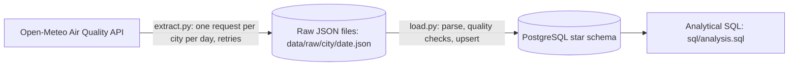

# Air Quality Pipeline


A small data pipeline in Python that pulls hourly air quality data for four Indian cities from a public API, stores every raw response on disk, checks its quality, and loads the readings into a PostgreSQL star schema. Re-running it is safe: loads are idempotent. The whole thing runs with Docker.

> **Data note:** the readings come from the Open-Meteo Air Quality API, which provides **modeled data at roughly 11 km resolution, not sensor measurements**. Treat the values as estimates for an area, not as what a monitoring station recorded.

## Architecture



1. **Extract** (`src/extract.py`): requests one day of hourly data per city, saves the response exactly as received, and prints a summary (rows per city, missing values, PM2.5 mean and max).
2. **Load** (`src/load.py`): reads the saved files, runs the quality checks in `src/quality.py`, and upserts the data that passes into PostgreSQL.

Raw files are kept so the database can always be rebuilt without calling the API again.

## What it collects

- **Cities:** Mangaluru, Bengaluru, Delhi, Chennai
- **Variables (hourly):** `pm10`, `pm2_5`, `carbon_monoxide`, `dust`, `carbon_dioxide`, `nitrogen_dioxide` (units as returned by the API; see the Open-Meteo documentation)
- **Granularity:** one row per city per hour

## Data model

| Table | Purpose | Key columns |
|---|---|---|
| `dim_city` | One row per city | `city_id` (identity primary key), `city_name` (unique), `latitude`, `longitude` as `NUMERIC(9,6)` |
| `fact_air_quality` | One row per city per hour | primary key `(city_id, reading_time)`, six nullable `NUMERIC(8,2)` pollutant columns |

## Design decisions

- **Idempotent loads.** Both tables use `INSERT ... ON CONFLICT DO UPDATE`. Loading the same files twice leaves the same row count, and corrected values overwrite stale ones.
- **Composite primary key instead of an auto-increment id.** `(city_id, reading_time)` is what defines "the same reading", so the database itself blocks duplicates.
- **Forecast days are not loaded.** Today and later dates contain predictions, so extract skips them and load ignores their files. The rule lives in one function (`is_past`) shared by both steps and covered by tests.
- **Nulls stay NULL.** Missing API values become SQL `NULL`, not `0` and not `NaN`. The load step deliberately avoids pandas for this reason.
- **Validate before writing.** A response whose pollutant arrays differ in length from the time array is rejected, and every file passes the quality checks below before anything reaches the database.
- **Retries only where they help.** Timeouts and connection errors are retried up to 3 attempts with a doubling wait. HTTP errors (4xx/5xx) are not retried.
- **Plain `TIMESTAMP`.** All four cities are in India Standard Time with no daylight saving, and the API is asked for each location's local time.
- **Plain SQL, no ORM.** The SQL is written by hand with `psycopg` so the queries stay visible.
- **Configuration from environment.** Database settings live in a `.env` file that is git-ignored; only `.env.example` is committed.

## Data quality checks

Each day file is checked in `src/quality.py` before it is loaded.

| Result | What triggers it | What happens |
|---|---|---|
| **Error** | not exactly 24 rows; duplicate timestamps; timestamps outside the file's date; a negative value; a pollutant that is null for all 24 hours | the file is not loaded, the error is logged, and `load.py` exits with code 1 |
| **Warning** | some null values in a column; PM2.5 higher than PM10 in an hour | the file is loaded and the problem is logged |

Incomplete days are rejected on purpose: daily averages or maximums computed from a partial day can be biased, for example if the missing hour was the peak. The cost is that the good hours of that day are skipped too. The fix is to re-run `extract.py` for that city and day, then load again.

In a run over past dates only (1 to 10 October 2026, 4 cities, 240 rows per city), none of the six pollutant columns had missing values. Earlier runs that included forecast days showed many missing `carbon_dioxide` values, which is why forecast days are excluded.

## Getting started

**Requirements:** Docker Desktop and Git. To run the Python scripts directly you also need Python 3.10+.

### With Docker (recommended)

```powershell
git clone https://github.com/Raopruthvi/Air-quality-pipeline.git
cd Air-quality-pipeline

Copy-Item .env.example .env           # Linux/macOS: cp .env.example .env
# edit .env and set your own DB_PASSWORD

docker compose build pipeline
docker compose up -d                  # starts PostgreSQL and creates the tables on first start
docker compose run --rm pipeline python src/extract.py 2026-10-01 2026-10-10
docker compose run --rm pipeline      # loads the saved files (default command)
```

- `docker compose up -d` starts only the database. The `pipeline` service sits behind a compose profile and runs only when you ask for it with `docker compose run`.
- The pipeline container waits for the database healthcheck before starting.
- Raw files are written to `./data/raw` on your machine through a bind mount, so they survive the container.
- The first start of the database creates the tables from `sql/schema.sql`. The schema script drops and recreates the tables, so do not run it against a database you want to keep.
- The database credentials are fixed into the data volume on first start. To change them later, run `docker compose down -v` (this deletes the database; it can be rebuilt from the raw files), then start again.

### Without Docker for the Python scripts

Keep the database in Docker (`docker compose up -d`) and run the scripts from a virtual environment:

```powershell
python -m venv .venv
.\.venv\Scripts\Activate.ps1          # Linux/macOS: source .venv/bin/activate
pip install -r requirements.txt

python src/extract.py 2026-10-01 2026-10-10
python src/load.py
```

Dates are `YYYY-MM-DD` and must be in the past. With no arguments, `extract.py` fetches the day 5 days ago.

### Configuration

Settings come from `.env` (see `.env.example`): `DB_HOST`, `DB_PORT`, `DB_NAME`, `DB_USER`, `DB_PASSWORD`.

- Running scripts **on your machine**: `DB_HOST=localhost` and `DB_PORT=5434`. The compose file publishes the container's port 5432 on your machine's port 5434 (`5434:5432`).
- Running **inside the pipeline container**: compose sets `DB_HOST=postgres` and `DB_PORT=5432`. Inside a container, `localhost` means the container itself, so services reach each other by service name on the internal port.

## Analysis

`sql/analysis.sql` holds six queries on the star schema, each with a comment stating its question. Run them one at a time in a SQL client such as DBeaver, or all together with `psql -f sql/analysis.sql`.

1. **Coverage check:** city/days that do not have exactly 24 rows
2. **Worst hour of the day:** the hour with the highest average PM2.5 per city
3. **City ranking:** cities ranked by average PM2.5 (`RANK()`)
4. **3-day moving average** of daily PM2.5 per city (window function)
5. **Threshold days:** days per city with a daily average above the WHO 24-hour PM2.5 guideline of 15 µg/m³ (WHO global air quality guidelines, 2021; the source is cited in the file)
6. **Worst day per city:** the day with the highest average PM2.5

```sql
SELECT c.city_name, ROUND(AVG(f.pm2_5), 1) AS avg_pm25
FROM fact_air_quality f
JOIN dim_city c ON c.city_id = f.city_id
GROUP BY c.city_name
ORDER BY avg_pm25 DESC;
```

## Testing

```powershell
pytest -v
```

There are 18 tests, run automatically on every push by GitHub Actions:

- `tests/test_dates.py`: the past/forecast split, including that "today" counts as a forecast day, and that the two lists never overlap or lose a day.
- `tests/test_build_rows.py`: row shape, column order, nulls becoming `None`, and rejection of mismatched array lengths.
- `tests/test_retry.py`: retry with doubling wait, giving up after the maximum attempts, and not retrying HTTP errors. The network is replaced by a fake, so no real requests are made.
- `tests/test_quality.py`: each data quality rule, including which problems are errors and which are only warnings.

The tests cover pure logic and the retry behavior. They do not include an integration test against a real database.

## Project structure

```
.
├── src/
│   ├── extract.py        # fetch, retry, save raw JSON, summary
│   ├── load.py           # parse, quality checks, upsert into PostgreSQL
│   ├── quality.py        # data quality rules (errors and warnings)
│   └── config.py         # reads database settings from the environment
├── sql/
│   ├── schema.sql        # star schema (drops and recreates tables)
│   └── analysis.sql      # analytical queries
├── tests/                # pytest tests
├── .github/workflows/
│   └── ci.yml            # runs pytest on every push
├── Dockerfile            # image for the pipeline
├── docker-compose.yml    # PostgreSQL 16 and the pipeline service
├── .dockerignore
├── requirements.txt
├── pytest.ini
└── .env.example          # copy to .env
```

`data/raw/` holds the saved API responses and is git-ignored.

## Known limitations

- Data is modeled, hourly only, and covers four hard-coded cities.
- Retries cover timeouts and connection errors only. Rate-limit (429) and server (5xx) responses are not retried.
- A day that fails a quality check, or was never fetched, leaves a gap. The failure is logged and `load.py` exits with code 1, but nothing is recorded in the database about which days are missing.
- `load.py` re-reads every raw file on each run. That is fine at this size and would need an incremental approach at a larger one.
- All files are loaded in one transaction: a database error part-way through rolls back the whole run. Files rejected by the quality checks are skipped without affecting the rest.
- "Today" is taken from the machine's clock (UTC inside the Docker container), so for a few hours each night in India the day that counts as "today" can differ from the local date.
- Nothing runs on a schedule yet. Extract and load are started by hand.
- Credentials are for local development. `.env` is not a production secrets setup.
- The pipeline image also installs test dependencies; separating runtime and development requirements would make it smaller.
- Running `schema.sql` drops the existing tables.

## Possible future work

- Run extract and load on a schedule
- Integration test of the load step against a real PostgreSQL (for example with Testcontainers for Python)
- Incremental loading and a table that records missing days